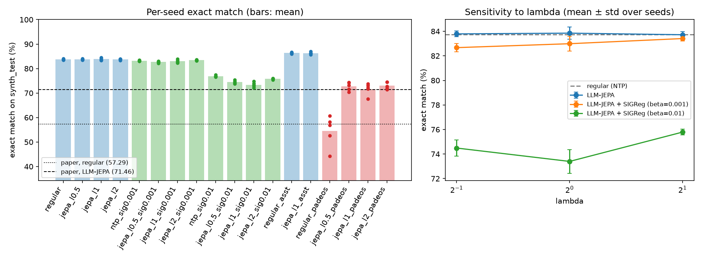

# llm-jepa-sigreg

A small, self-contained reproduction of LLM-JEPA fine-tuning (Huang, LeCun and Balestriero,
arXiv:2509.14252) for Llama-3.2-1B-Instruct on NL-RX-SYNTH, an audit of what the official
training pipeline actually optimizes, and an extension that adds SIGReg (LeJEPA,
arXiv:2511.08544) to the JEPA embeddings.

Write-up: [Auditing LLM-JEPA: the gain disappears once the baseline learns to stop](https://gonzalofuentes1.github.io/en/notes/llm-jepa-audit.html).

## Motivation

LLM-JEPA reports that adding a JEPA term to next-token prediction (NTP) raises exact match
on NL-RX-SYNTH from 57.29 ± 5.32 to 71.46 ± 1.34 for Llama-3.2-1B-Instruct (paper, Table 3).
LeJEPA argues that JEPA embeddings should be pushed towards an isotropic Gaussian with
SIGReg, which removes collapse heuristics and leaves a single trade-off weight. We ask
whether the LLM-JEPA gain reproduces, whether SIGReg helps or makes the method less
sensitive to its weight, and whether a padding detail of the official code changes the
picture.

## Findings in brief

All numbers are exact match (%) on the 2,000 NL-RX-SYNTH test examples, mean ± sample
standard deviation over five seeds, from `results/summary.md`.

* **The published numbers reproduce with the official padding.** With the official
  `pad_token = eos_token` fallback, regular fine-tuning reaches 54.55 ± 6.46 (paper
  57.29 ± 5.32) and LLM-JEPA (lambda = 1, k = 1) 71.64 ± 2.38 (paper 71.46 ± 1.34), a paired
  gain of +17.09 points (one-sided paired t-test p = 7.2e-4; the paper reports 1.0e-3).
* **The gain disappears once the end-of-turn token is supervised.** With the reserved
  `<|finetune_right_pad_id|>` as pad token, regular fine-tuning reaches 83.74 ± 0.27 and
  LLM-JEPA 83.79 ± 0.23, 83.85 ± 0.51 and 83.72 ± 0.26 for lambda = 0.5, 1, 2 (paired
  differences +0.05, +0.11, -0.02; two-sided p >= 0.49). The same holds with
  assistant-only labels (86.37 ± 0.26 vs 86.27 ± 0.50).
* **pad = eos is a termination bug.** In every condition without SIGReg the generation
  starts with the exact reference regex in 84 to 86% of the test examples ("prefix match").
  What changes is whether the model stops after it: the ratio exact match / prefix match is
  0.999 to 1.000 with the reserved pad, 0.647 for regular fine-tuning with pad = eos, and
  0.85 to 0.87 for LLM-JEPA with pad = eos. About two thirds of the errors of regular
  fine-tuning with pad = eos are a correct regex followed by extra tokens.
* **SIGReg does not help.** Adding SIGReg to the JEPA embeddings lowers exact match at every
  lambda (beta = 0.001: -0.31 to -1.12 points; beta = 0.01: -7.93 to -10.45 points against
  the same lambda without SIGReg) and makes results more, not less, sensitive to lambda
  (range of means over lambda: 0.13 for LLM-JEPA, 0.74 with beta = 0.001, 2.39 with
  beta = 0.01).

## Method

Each NL-RX-SYNTH example is a system / user / assistant conversation (natural-language
description, regular expression). Following the official code for Llama, three views are
encoded in one forward pass (3B sequences, right padded):

| view | content (Llama-3.2 chat template) |
|---|---|
| full | system + user + assistant |
| text | the user turn alone, plus k predictor tokens `<\|predictor_k\|>...<\|predictor_1\|>` appended to its content (the template inserts its default system header; the task system prompt is not included) |
| code | the assistant turn alone, keeping the `assistant` role |

The loss is

    L = L_NTP(full view) + lambda * (1 - cos(e_pred, e_target)) + beta * SIGReg([e_pred; e_target])

* `e_pred` and `e_target` are last-layer hidden states (after the final norm, identical to
  `hidden_states[-1]` in Hugging Face) of the text and code views at index
  `unpadded_length - 2` (`last_token = -2` for Llama), i.e. the token right before the final
  `<|eot_id|>`: `<|predictor_1|>` for the text view and the last regex token for the code
  view. No stop-gradient, no extra predictor network (the predictor tokens play that role).
* `L_NTP` is the mean token cross-entropy over the supervised positions of the full view;
  logits are computed only at those positions.
* SIGReg is the reference implementation from `lejepa` (`SlicingUnivariateTest` over
  `EppsPulley(t_max=3, n_points=17)`, 1024 random slices), applied to the 2B x 2048 matrix
  of stacked JEPA embeddings. `beta = 0` gives LLM-JEPA, `lambda = beta = 0` gives regular
  fine-tuning (and the text/code views are then not computed at all, as in the official
  `--regular` mode).

Batch for SIGReg. The Epps-Pulley statistic is computed on the samples of one call, so a
small batch makes it noisy. We put the whole global batch of the official run (128
conversations, i.e. 8 GPUs x 4 per device x 4 accumulation steps in `run.sh`) in a single
micro-batch on one H100 (about 23 GB with activation checkpointing). SIGReg therefore sees
256 embeddings per step, the optimization batch is unchanged and no learning-rate rescaling
is needed. Gradient accumulation is supported (`--grad-accum`) but unused.

## What the official pipeline actually trains on

`scripts/probe_official.py` runs the data path of the official `finetune.py`
(`load_and_prepare_dataset`, the `DataCollatorForLanguageModeling` it uses, and
`RepresentationTrainer._last_token_index`) on two training examples with the Meta tokenizer;
the output is in `results/official_probe.txt`. Findings:

1. **Embedding tokens do not depend on the pad token.** `_last_token_index` measures the
   unpadded length with the attention mask, not with token ids. With `pad = eos` and with
   `pad = <|finetune_right_pad_id|>` the index lands on `<|predictor_1|>` (text view) and on
   the last regex token (code view), followed by the real `<|eot_id|>` in both cases. This
   is also what our implementation uses (`tests/test_data.py`,
   `tests/test_real_tokenizer.py`).
2. **The NTP labels cover the whole conversation.** `create_masked_labels` builds
   assistant-only labels, but `DataCollatorForLanguageModeling(mlm=False)` overwrites
   `labels` with `input_ids` and masks only tokens equal to `pad_token_id`. The model is thus
   trained on the system header, the date, the user turn and the answer (74 of 77 tokens in
   the first example). We reproduce this by default (`--label-scope all`) and also run the
   assistant-only variant (`--label-scope assistant`).
3. **`pad = eos` removes every end-of-turn target.** Meta's tokenizer has no pad token, so
   the code falls back to `pad_token = eos_token = <|eot_id|>`; the collator then masks the
   three genuine `<|eot_id|>` of every conversation (system, user and assistant turns). The
   model is never trained to end its answer. With the reserved pad token all 77 tokens,
   including the three `<|eot_id|>`, are supervised. This is the issue raised in
   galilai-group/llm-jepa issues #9 and #10. `--pad-as-eos` reproduces it.
4. Other details we keep for fidelity: two BOS tokens per sequence (the rendered template
   already starts with `<|begin_of_text|>` and is tokenized with `add_special_tokens=True`;
   the same happens at evaluation), and the template's default system header in the text and
   code views. The template inserts today's date; we fix it to `26 Jul 2024` (the template's
   own default) so that runs are reproducible.

Caveat: the probe ran with transformers 5.24.0, not the 4.55.2 listed in the official
`setup.sh`; the collator logic involved is the same, and issue #10 reports the same masking.

## Setup

* Hardware: one NVIDIA H100 80GB HBM3 per run (Slurm, at most two runs in parallel).
* Software: Python 3.12, torch 2.15.0+cu132, transformers 5.24.0,
  lejepa @ c293d291ca87cd4fddee9d3fffe4e914c7272052.
* Model: `unsloth/Llama-3.2-1B-Instruct` at revision
  5a8abab4a5d6f164389b1079fb721cfab8d7126c, an ungated mirror of
  `meta-llama/Llama-3.2-1B-Instruct`. `scripts/verify_mirror.py`
  (`results/mirror_check.json`) checks that `model.safetensors` has the same sha256 as
  Meta's (1ff795ff...8538f, read from the public Hub metadata), and that both tokenizers
  produce identical ids on every view of all 10,000 examples. Meta's files are gated; the
  Meta tokenizer was read from `alpindale/Llama-3.2-1B-Instruct`, whose `config.json`,
  `generation_config.json`, `tokenizer.json` and `tokenizer_config.json` have the same git
  blob ids (content hashes) as Meta's. The mirror's `config.json` differs only in
  `eos_token_id` (128009 instead of [128001, 128008, 128009]), `pad_token_id` (128004),
  `transformers_version` and an `unsloth_fixed` flag; its tokenizer sets
  `pad_token = <|finetune_right_pad_id|>` and left padding. We set the pad token and right
  padding explicitly, and stop generation on `<|eot_id|>` only, as the official evaluation.
* Data: `synth_train.jsonl` (8,000) and `synth_test.jsonl` (2,000), downloaded at run time
  from the official repository at commit ea0017c654ad917066ff32afc88276bea8ca5f7e and checked
  against pinned sha256 digests (`src/llm_jepa_sigreg/data.py`).
* Training (official defaults): full fine-tuning in bf16 weights, AdamW (0.9, 0.999,
  eps 1e-8, no weight decay), lr 2e-5 with linear decay to 0 and no warmup, gradient
  clipping at 1.0, global batch 128, 4 epochs (63 steps per epoch, 252 steps; the last batch
  of each epoch has 64 examples), k = 1 predictor token, `last_token = -2`. The 11 extra
  special tokens of the official code are added and the embeddings resized.
* Seeds: 82, 23, 37, 84, 4 (as in `run.sh`). The seed sets data order and the
  initialization of the new token embeddings.
* Evaluation (official rule): greedy decoding, at most 128 new tokens, stop at
  `<|eot_id|>`, decode without special tokens, strip, exact string match with the reference
  regex, on all 2,000 test examples. We batch 250 prompts with left padding.
* Embedding diagnostics on the test set (`src/llm_jepa_sigreg/evaluate.py`): mean
  cos(e_pred, e_target); the SIGReg statistic averaged over chunks of 128 test pairs (256
  embeddings, as in training) with a fixed set of slices; effective rank (Roy and Vetterli,
  2007) of the centered e_pred and e_target matrices. They are also computed for regular
  runs, whose `<|predictor_1|>` embedding is never trained.
* No checkpoint is written: each run trains, evaluates in the same process and stores its
  metrics, per-step log and predictions in `results/runs/<condition>/s<seed>.*`.

### Choice of beta

beta was chosen before running the main grid, on a validation split carved from the
training set (train on the first 7,000 training examples, evaluate on the last 1,000; the
test set is not used), with LLM-JEPA lambda = 1, k = 1 and seed 82
(`scripts/grid_beta_pilot.txt`, `results/pilot_beta.md`):

| beta | split | exact match (%) | EOT rate | SIGReg | cos | erank pred / target |
|---|---|---|---|---|---|---|
| 0 | synth_train[-1000:] | 82.90 | 1.000 | 396.0 | 1.000 | 464.8 / 354.1 |
| 0.001 | synth_train[-1000:] | 81.50 | 1.000 | 41.9 | 0.997 | 21.3 / 29.7 |
| 0.003 | synth_train[-1000:] | 78.20 | 1.000 | 17.2 | 0.990 | 73.7 / 87.9 |
| 0.01 | synth_train[-1000:] | 71.00 | 1.000 | 10.9 | 0.970 | 136.0 / 149.2 |
| 0.03 | synth_train[-1000:] | 57.60 | 1.000 | 8.7 | 0.850 | 278.9 / 296.4 |
| 0.1 | synth_train[-1000:] | 29.70 | 0.999 | 2.9 | 0.227 | 661.4 / 705.5 |

At the first step the SIGReg statistic of the batch embeddings is about 160 while the NTP
loss is about 5 (`results/runs/*/s82.train_log.jsonl`); with beta = 0.1 the gradient norm
before clipping is 888 instead of 207 for beta = 0 (seed 82, validation pilot), and SIGReg
overrides the JEPA term (validation cosine 0.227 instead of 1.000). Validation exact match
decreases monotonically with beta. We took as "small" the smallest value that halves the
validation SIGReg statistic (0.001) and as "medium" ten times that (0.01).

## Results

91 runs in the main grid (`scripts/grid_main.txt`), 6 beta-selection pilot runs and two
20-step timing pilots: 5.69 GPU-hours in total (`results/compute.json`, from `sacct`). A
regular run trains in about 1.6 minutes and a run with text and code views in about 3.5
minutes (252 steps, peak memory 23 GB); evaluation takes about 10 seconds.

Conditions: `regular` (NTP only), `jepa_l<lambda>`, `..._sig<beta>` (with SIGReg),
`ntp_sig<beta>` (NTP + SIGReg, no JEPA term), `..._padeos` (official `pad = eos`),
`..._asst` (assistant-only labels), `base_zeroshot` (no fine-tuning). Unless marked
`_padeos` or `_asst`, runs use the reserved pad token and the official label scope (whole
conversation).



### All conditions

Columns: paired mean difference and two-sided paired t-test against the regular run with the
same padding and label scope; fraction of generations that emit `<|eot_id|>` within 128
tokens; fraction whose stripped text starts with the exact reference; SIGReg statistic of
the test embeddings (lower is closer to N(0, I)); effective rank of e_pred / e_target.

| condition | n | exact match (%) | delta vs regular | p (paired, two-sided) | EOT rate | prefix match | test SIGReg | erank pred / target |
|---|---|---|---|---|---|---|---|---|
| base_zeroshot | 1 | 0.00 |  |  | 0.051 | 0.000 | 155.0 | 714.1 / 733.8 |
| regular | 5 | 83.74 ± 0.27 |  |  | 1.000 | 0.838 | 182.4 | 620.7 / 620.5 |
| jepa_l0.5 | 5 | 83.79 ± 0.23 | +0.05 | 0.508 | 1.000 | 0.839 | 393.2 | 691.8 / 516.7 |
| jepa_l1 | 5 | 83.85 ± 0.51 | +0.11 | 0.493 | 1.000 | 0.839 | 396.5 | 755.5 / 580.9 |
| jepa_l2 | 5 | 83.72 ± 0.26 | -0.02 | 0.888 | 1.000 | 0.838 | 405.7 | 825.5 / 650.5 |
| ntp_sig0.001 | 5 | 83.16 ± 0.22 | -0.58 | 0.003 | 1.000 | 0.833 | 2.8 | 1005.6 / 1058.4 |
| jepa_l0.5_sig0.001 | 5 | 82.67 ± 0.33 | -1.07 | 6.8e-04 | 1.000 | 0.828 | 20.8 | 72.6 / 93.2 |
| jepa_l1_sig0.001 | 5 | 82.99 ± 0.59 | -0.75 | 0.015 | 1.000 | 0.831 | 38.8 | 32.7 / 45.4 |
| jepa_l2_sig0.001 | 5 | 83.41 ± 0.20 | -0.33 | 0.045 | 1.000 | 0.835 | 106.0 | 995.4 / 870.2 |
| ntp_sig0.01 | 5 | 76.91 ± 0.35 | -6.83 | 4.4e-07 | 1.000 | 0.771 | 2.0 | 1190.1 / 1195.0 |
| jepa_l0.5_sig0.01 | 5 | 74.49 ± 0.66 | -9.25 | 4.4e-06 | 1.000 | 0.747 | 10.4 | 260.5 / 294.9 |
| jepa_l1_sig0.01 | 5 | 73.40 ± 0.97 | -10.34 | 4.2e-05 | 1.000 | 0.736 | 11.4 | 168.4 / 190.0 |
| jepa_l2_sig0.01 | 5 | 75.79 ± 0.23 | -7.95 | 2.1e-06 | 1.000 | 0.760 | 10.1 | 137.7 / 162.1 |
| regular_asst | 5 | 86.37 ± 0.26 |  |  | 1.000 | 0.864 | 167.0 | 730.0 / 550.7 |
| jepa_l1_asst | 5 | 86.27 ± 0.50 | -0.10 | 0.722 | 1.000 | 0.863 | 408.1 | 720.7 / 537.8 |
| regular_padeos | 5 | 54.55 ± 6.46 |  |  | 0.970 | 0.844 | 154.3 | 650.2 / 648.1 |
| jepa_l0.5_padeos | 5 | 72.76 ± 1.74 | +18.21 | 0.002 | 0.996 | 0.845 | 392.1 | 686.6 / 513.9 |
| jepa_l1_padeos | 5 | 71.64 ± 2.38 | +17.09 | 0.001 | 0.996 | 0.844 | 396.2 | 752.2 / 579.4 |
| jepa_l2_padeos | 5 | 73.02 ± 1.43 | +18.47 | 0.002 | 0.999 | 0.843 | 404.5 | 817.3 / 645.9 |

### SIGReg against the same lambda without SIGReg (paired by seed)

| condition | exact match (%) | reference without SIGReg | reference (%) | delta | p (paired, two-sided) |
|---|---|---|---|---|---|
| ntp_sig0.001 | 83.16 ± 0.22 | regular | 83.74 ± 0.27 | -0.58 | 0.003 |
| jepa_l0.5_sig0.001 | 82.67 ± 0.33 | jepa_l0.5 | 83.79 ± 0.23 | -1.12 | 8.1e-04 |
| jepa_l1_sig0.001 | 82.99 ± 0.59 | jepa_l1 | 83.85 ± 0.51 | -0.86 | 0.031 |
| jepa_l2_sig0.001 | 83.41 ± 0.20 | jepa_l2 | 83.72 ± 0.26 | -0.31 | 0.062 |
| ntp_sig0.01 | 76.91 ± 0.35 | regular | 83.74 ± 0.27 | -6.83 | 4.4e-07 |
| jepa_l0.5_sig0.01 | 74.49 ± 0.66 | jepa_l0.5 | 83.79 ± 0.23 | -9.30 | 7.4e-06 |
| jepa_l1_sig0.01 | 73.40 ± 0.97 | jepa_l1 | 83.85 ± 0.51 | -10.45 | 5.0e-05 |
| jepa_l2_sig0.01 | 75.79 ± 0.23 | jepa_l2 | 83.72 ± 0.26 | -7.93 | 4.2e-07 |

### Official pad = eos against the reserved pad token (paired by seed)

| condition | exact match (%) | reference with reserved pad | reference (%) | delta | p (paired, two-sided) |
|---|---|---|---|---|---|
| regular_padeos | 54.55 ± 6.46 | regular | 83.74 ± 0.27 | -29.19 | 5.2e-04 |
| jepa_l0.5_padeos | 72.76 ± 1.74 | jepa_l0.5 | 83.79 ± 0.23 | -11.03 | 9.6e-05 |
| jepa_l1_padeos | 71.64 ± 2.38 | jepa_l1 | 83.85 ± 0.51 | -12.21 | 2.9e-04 |
| jepa_l2_padeos | 73.02 ± 1.43 | jepa_l2 | 83.72 ± 0.26 | -10.70 | 7.3e-05 |

### Sensitivity to lambda (mean ± std over seeds)

| series | lambda = 0.5 | lambda = 1 | lambda = 2 | max - min of means |
|---|---|---|---|---|
| LLM-JEPA | 83.79 ± 0.23 | 83.85 ± 0.51 | 83.72 ± 0.26 | 0.13 |
| LLM-JEPA + SIGReg (beta=0.001) | 82.67 ± 0.33 | 82.99 ± 0.59 | 83.41 ± 0.20 | 0.74 |
| LLM-JEPA + SIGReg (beta=0.01) | 74.49 ± 0.66 | 73.40 ± 0.97 | 75.79 ± 0.23 | 2.39 |
| LLM-JEPA, pad = eos | 72.76 ± 1.74 | 71.64 ± 2.38 | 73.02 ± 1.43 | 1.38 |

### Hypotheses

**H1, the LLM-JEPA gain reproduces: only with the official padding.** Running the official
data path (pad = eos) we obtain 54.55 ± 6.46 for regular fine-tuning and 71.64 ± 2.38 for
LLM-JEPA, within one standard deviation of the paper's 57.29 ± 5.32 and 71.46 ± 1.34, with a
similar paired p-value. With the reserved pad token, which only changes whether
`<|eot_id|>` is a training target, the baseline rises to 83.74 ± 0.27 and LLM-JEPA brings no
gain at lambda = 0.5, 1 or 2, nor with assistant-only labels. We therefore do not reproduce
the LLM-JEPA improvement on this model and dataset once the baseline is trained to stop:
the published gap is explained by the baseline's termination failure.

**H2, SIGReg keeps or improves the best point and reduces sensitivity to lambda: rejected.**
SIGReg lowers exact match at every lambda and both betas, significantly so in 7 of 8
comparisons (the exception is lambda = 2, beta = 0.001: -0.31, p = 0.062), and widens the
spread over lambda. Without SIGReg, LLM-JEPA is already flat in lambda (0.13 points). On the
embeddings, SIGReg does what it is designed for when used alone (`ntp_sig`: test statistic
2.0 to 2.8 against 182.4 for regular fine-tuning, higher effective rank), but combined with
the JEPA term at beta = 0.001 the statistic stays far from that level (20.8 to 106.0) and
the effective rank of e_pred and e_target falls from several hundred to 33 to 93 at
lambda = 0.5 and 1. With beta = 0.01, the lower exact match comes with a lower prefix match
(0.74 to 0.77 against 0.84), i.e. wrong regexes rather than termination errors. We did not
investigate the mechanism further.

**H3, the pad = eos bug changes the result: confirmed.** It costs 29.19 points to regular
fine-tuning and 10.70 to 12.21 points to LLM-JEPA (all p < 0.001, paired), raises the
standard deviation of the baseline over seeds from 0.27 to 6.46, and creates the apparent
LLM-JEPA advantage. The mechanism is visible in the predictions
(`results/runs/*/s*.predictions.jsonl.gz`): prefix match is unchanged (about 0.84), but
with pad = eos the model often keeps generating after a correct regex, most commonly
appending another `.*`. With pad = eos, 554 of the 863
errors of `regular_padeos` seed 82 start with the exact reference. LLM-JEPA partly repairs
termination (exact / prefix 0.85 to 0.87 against 0.647). A plausible but untested reason is
that the code-view embedding is taken at the last regex token, the position whose next
token is the missing `<|eot_id|>` target, but we have not verified it.

The embedding token itself is not affected by the bug (see the audit above). The answer to
"which token does the official code use with pad = eos, and which should it use" is the same
token in both cases: `<|predictor_1|>` for the text view and the last regex token for the
code view.

## Limitations

* One model, one dataset, five seeds; the paired tests use the same five seeds and are not
  corrected for multiple comparisons.
* Single GPU instead of 8-GPU DDP. The global batch, optimizer, schedule and number of
  epochs match, but the loss normalization differs slightly: the official JEPA trainer
  averages the NTP loss per device micro-batch of 4 and does not divide by the accumulation
  steps (a uniform factor that matters only through gradient clipping), and the official run
  takes about 248 optimizer steps instead of our 252.
* Batched, left-padded greedy decoding in bf16 can differ from the official one-prompt-at-a-
  time decoding on near ties.
* beta was selected with one seed on a validation split; lambda in {0.5, 1, 2} and k = 1 were
  taken from the paper and `run.sh`, not tuned here.
* SIGReg with 256 samples in 2048 dimensions only checks one-dimensional projections of a
  sample that spans at most 256 directions; it is a weak test of isotropy in this regime.
* Only the default three-sequence path of the official code (as in `run.sh`) is reproduced,
  not its `--additive_mask` packing.
* Paper numbers come from a different software stack (transformers 4.55.2) and an unknown
  date string in the system header.

## How to run

```bash
pip install torch  # pick the build for your CUDA
pip install -e ".[dev]"
pytest -q                     # CPU tests with a tiny random Llama and an offline tokenizer
LLM_JEPA_TOKENIZER=unsloth/Llama-3.2-1B-Instruct pytest tests/test_real_tokenizer.py

# one run (downloads the data from the official repository on first use)
python -m llm_jepa_sigreg.train --out-dir runs/jepa --tag jepa_l1 --seed 82 --lbd 1
python -m llm_jepa_sigreg.train --out-dir runs/sig --tag jepa_l1_sig0.001 --seed 82 \
  --lbd 1 --beta 0.001
python -m llm_jepa_sigreg.train --out-dir runs/off --tag regular_padeos --seed 82 --pad-as-eos

# the grids used here (Slurm, one GPU per worker; submit two workers for two GPUs)
sbatch scripts/worker.sbatch scripts/grid_beta_pilot.txt
sbatch scripts/worker.sbatch scripts/grid_main.txt
python scripts/aggregate.py   # results/summary.csv, results/summary.md, results/figure.png

# checks
python scripts/verify_mirror.py
python scripts/probe_official.py /path/to/llm-jepa-clone /path/to/synth_train.jsonl
```

Main flags of `llm_jepa_sigreg.train`: `--lbd` (lambda), `--beta`, `--predictors` (k),
`--pad-as-eos`, `--label-scope {all,assistant}`, `--holdout N`, `--batch-size`,
`--grad-accum`, `--lr`, `--epochs`.

## Repository layout

* `src/llm_jepa_sigreg/`: `data.py` (download, views, labels, batching), `model.py`
  (tokenizer and model setup, NTP / JEPA / SIGReg losses), `train.py` (training loop and
  CLI), `evaluate.py` (generation, exact match, embedding diagnostics).
* `scripts/`: Slurm scripts, grids, `aggregate.py`, `verify_mirror.py`,
  `probe_official.py`, `gpu_hours.py`.
* `results/`: per-run metrics, logs and predictions, `summary.csv`, `summary.md`,
  `figure.png`, `pilot_beta.md`, `mirror_check.json`, `official_probe.txt`,
  `compute.json`.
* `tests/`: CPU tests (label masks with both pad choices, embedding indices, reduction to
  NTP when lambda = beta = 0, gradient through SIGReg, a CLI smoke test).

## Citation

```bibtex
@article{huang2025llmjepa,
  title   = {LLM-JEPA: Large Language Models Meet Joint Embedding Predictive Architectures},
  author  = {Huang, Hai and LeCun, Yann and Balestriero, Randall},
  journal = {arXiv preprint arXiv:2509.14252},
  year    = {2025}
}

@misc{balestriero2025lejepa,
  title         = {LeJEPA: Provable and Scalable Self-Supervised Learning Without the Heuristics},
  author        = {Balestriero, Randall and LeCun, Yann},
  year          = {2025},
  eprint        = {2511.08544},
  archivePrefix = {arXiv},
  primaryClass  = {cs.LG}
}
```

## License and attribution

Apache-2.0 (see `LICENSE` and `NOTICE`). The NL-RX-SYNTH files are not stored here; they
are downloaded from the official LLM-JEPA repository
(https://github.com/galilai-group/llm-jepa, Apache-2.0), which preprocessed them from NL-RX
(Locascio et al., 2016). SIGReg comes from the `lejepa` package
(https://github.com/galilai-group/lejepa). No code from the official LLM-JEPA repository is
included.
